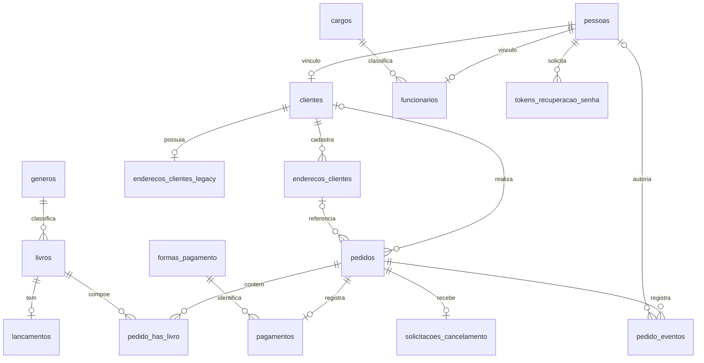

# Tabelas e relacionamentos do BookShop 4

O BookShop usa PostgreSQL. Uma **chave primária (PK)** identifica cada linha. Uma **chave estrangeira (FK)** aponta para o registro relacionado em outra tabela.

## Para abrir o diagrama

Abra um diagrama PostgreSQL no DrawSQL e carregue o [modelo de 15 tabelas](bookshop4_drawsql_principal.sql) em **File → Import → Begin Import**. O banco local tem **17 tabelas**. O modelo de apresentação omite `tokens_recuperacao_senha` e `enderecos_clientes_legacy` para caber no plano gratuito.

## O que cada tabela guarda

| Área | Tabela | O que guarda |
| --- | --- | --- |
| Pessoas | `pessoas` | Cadastro de acesso e perfil. O CPF identifica a pessoa. |
| Pessoas | `clientes` | Vínculo de cliente de uma pessoa. O CPF também é FK para `pessoas`. |
| Pessoas | `funcionarios` | Vínculo funcional, cargo e salário. Uma pessoa pode ser cliente e funcionária. |
| Pessoas | `cargos` | Cargos atribuídos aos funcionários, como Gerente. |
| Pessoas | `enderecos_clientes` | Endereços do cliente. Cada cliente pode cadastrar vários. |
| Pessoas | `tokens_recuperacao_senha` | Códigos de recuperação de conta em formato de hash e sua validade. |
| Catálogo | `generos` | Categorias usadas para classificar os livros. |
| Catálogo | `livros` | Título, autor, editora, preço, estoque e caminho da capa. Cada livro tem um gênero. |
| Catálogo | `lancamentos` | Data e país de lançamento. Um livro pode ter até um lançamento vinculado. |
| Compras | `pedidos` | Origem, status, previsão, valores e endereço da compra. O vínculo com cliente é opcional para permitir pedidos presenciais sem cadastro. |
| Compras | `pedido_has_livro` | Livros de cada pedido, com quantidade e preço unitário da compra. A PK combina livro e pedido. |
| Compras | `formas_pagamento` | Modalidades de pagamento e quais estão disponíveis. |
| Compras | `pagamentos` | Forma, valor e situação do pagamento. O ID do pedido é PK e FK, por isso cada pedido admite até um pagamento. |
| Compras | `pedido_eventos` | Histórico de status, observações e reembolsos, com responsável quando disponível. |
| Compras | `solicitacoes_cancelamento` | Motivo, anexo e decisão sobre o pedido de cancelamento. Cada pedido admite até uma solicitação. |
| Promoções | `promocoes` | Campanhas, critérios, percentual e validade. O desconto aplicado é copiado para o pedido em `desconto_registro`, preservando o valor da compra. |
| Legado | `enderecos_clientes_legacy` | Estrutura de endereços de uma versão anterior, presente no banco local. |

## Como as tabelas se conectam

No diagrama, `1` representa um registro, `0..1` um vínculo opcional e `0..N` zero ou vários registros.

Um pedido pode conter vários livros, e o mesmo livro pode aparecer em vários pedidos. A tabela `pedido_has_livro` faz essa ligação. O endereço usado na compra é copiado para `pedidos`, assim o histórico continua mostrando o endereço daquele dia se o cliente atualizar o cadastro.

Para criar um banco novo de demonstração, execute o [SQL de instalação](instalar_bookshop4.sql) em um banco PostgreSQL vazio. [Como executar o projeto](../README.md)
